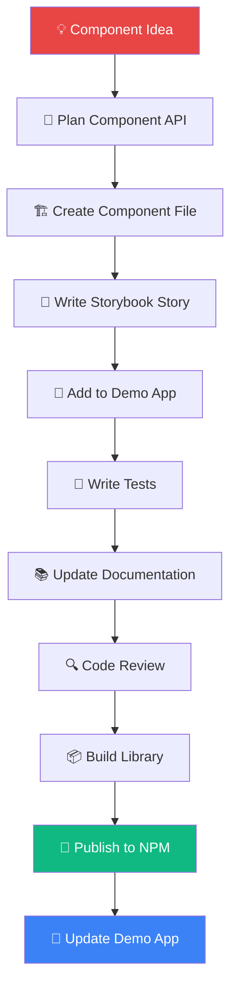
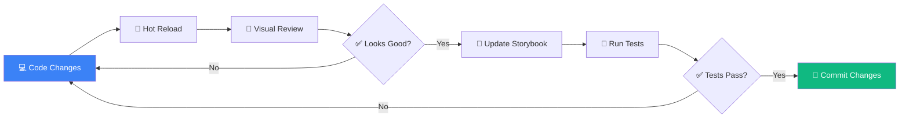
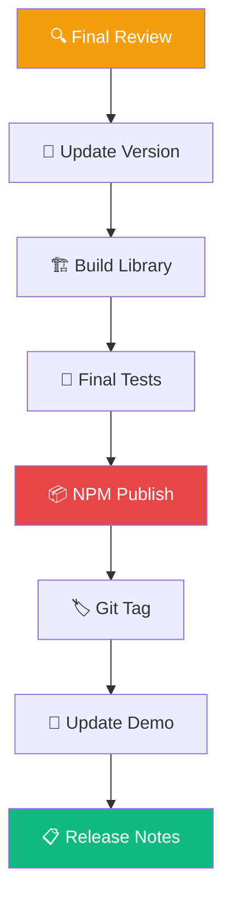
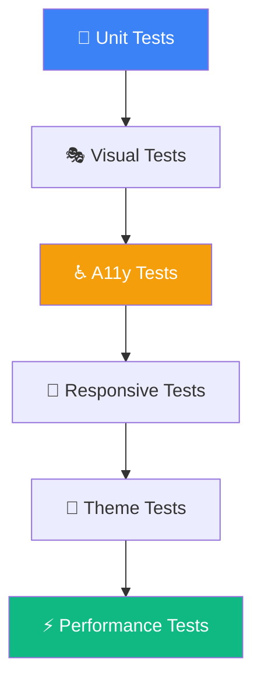

# 🛠️ Component Creation Guide

**A complete guide to creating, documenting, and publishing components in UI Heat**

---

## 📋 Table of Contents

1. [Overview](#-overview)
2. [Prerequisites](#-prerequisites)
3. [Step-by-Step Process](#-step-by-step-process)
4. [Component Development Workflow](#-component-development-workflow)
5. [Testing & Quality Assurance](#-testing--quality-assurance)
6. [Publishing to NPM](#-publishing-to-npm)
7. [Best Practices](#-best-practices)
8. [Troubleshooting](#-troubleshooting)

---

## 🎯 Overview

This guide walks you through the complete process of creating a new component in the UI Heat ecosystem, from initial development to NPM publication.

### 🔄 Component Lifecycle Diagram



---

## ✅ Prerequisites

Before creating a new component, ensure you have:

- [x] **Node.js 16+** installed
- [x] **npm** or **yarn** package manager
- [x] **Git** for version control
- [x] Development environment set up (see main README)
- [x] Understanding of React, PropTypes, and styled-components

### 🔧 Environment Setup

```bash
# Clone and set up the repository
git clone https://github.com/HoseaCodes/ui-library.git
cd ui-library

# Install demo app dependencies
npm install

# Install library dependencies
cd packages && npm install && cd ..

# Verify setup
npm start  # Should open demo app at localhost:3000
```

---

## 🚀 Step-by-Step Process

### Step 1: 📝 Plan Your Component

Before writing code, define your component's:

- **Purpose**: What problem does it solve?
- **API**: What props will it accept?
- **Variants**: What visual/behavioral variations will it support?
- **Accessibility**: What ARIA attributes are needed?

**Example Planning Document:**
```markdown
## Alert Component
- **Purpose**: Display contextual feedback messages
- **Variants**: success, warning, error, info
- **Props**: 
  - variant: 'success' | 'warning' | 'error' | 'info'
  - title?: string
  - children: ReactNode
  - dismissible?: boolean
  - onDismiss?: () => void
- **Accessibility**: ARIA role="alert", proper color contrast
```

### Step 2: 🏗️ Create the Component

#### 2.1 Create Component Directory

```bash
cd packages/src/components
mkdir Alert
cd Alert
```

#### 2.2 Create Component Files

Create the main component file:

**`Alert.jsx`**
```jsx
import React from 'react';
import PropTypes from 'prop-types';
import styled from 'styled-components';
import './Alert.css';

const StyledAlert = styled.div`
  display: flex;
  align-items: flex-start;
  padding: 1rem;
  border-radius: 8px;
  margin-bottom: 1rem;
  transition: all 0.3s ease;
  
  ${props => {
    switch (props.variant) {
      case 'success':
        return `
          background-color: #D1FAE5;
          border-left: 4px solid #10B981;
          color: #047857;
        `;
      case 'warning':
        return `
          background-color: #FEF3C7;
          border-left: 4px solid #F59E0B;
          color: #92400E;
        `;
      case 'error':
        return `
          background-color: #FEE2E2;
          border-left: 4px solid #EF4444;
          color: #B91C1C;
        `;
      case 'info':
      default:
        return `
          background-color: #DBEAFE;
          border-left: 4px solid #3B82F6;
          color: #1E40AF;
        `;
    }
  }}
`;

const AlertContent = styled.div`
  flex: 1;
`;

const AlertTitle = styled.div`
  font-weight: 600;
  margin-bottom: 0.25rem;
`;

const AlertMessage = styled.div`
  font-size: 0.875rem;
  line-height: 1.5;
`;

const DismissButton = styled.button`
  background: none;
  border: none;
  font-size: 1.25rem;
  cursor: pointer;
  color: currentColor;
  opacity: 0.7;
  margin-left: 0.5rem;
  
  &:hover {
    opacity: 1;
  }
`;

/**
 * Alert component for displaying contextual feedback messages
 * Supports different variants and optional dismiss functionality
 */
export const Alert = ({ 
  variant = 'info', 
  title, 
  children, 
  dismissible = false, 
  onDismiss,
  className,
  ...props 
}) => {
  return (
    <StyledAlert 
      variant={variant}
      className={`uiheat-alert uiheat-alert--${variant} ${className || ''}`}
      role="alert"
      {...props}
    >
      <AlertContent>
        {title && <AlertTitle>{title}</AlertTitle>}
        <AlertMessage>{children}</AlertMessage>
      </AlertContent>
      {dismissible && (
        <DismissButton 
          onClick={onDismiss}
          aria-label="Dismiss alert"
        >
          ×
        </DismissButton>
      )}
    </StyledAlert>
  );
};

Alert.propTypes = {
  /** The visual variant of the alert */
  variant: PropTypes.oneOf(['success', 'warning', 'error', 'info']),
  /** Optional title for the alert */
  title: PropTypes.string,
  /** The alert message content */
  children: PropTypes.node.isRequired,
  /** Whether the alert can be dismissed */
  dismissible: PropTypes.bool,
  /** Callback function when alert is dismissed */
  onDismiss: PropTypes.func,
  /** Additional CSS classes */
  className: PropTypes.string,
};

export default Alert;
```

Create the CSS file for additional styling:

**`Alert.css`**
```css
.uiheat-alert {
  box-shadow: 0 1px 3px rgba(0, 0, 0, 0.1);
}

.uiheat-alert--success {
  /* Success-specific styles if needed */
}

.uiheat-alert--warning {
  /* Warning-specific styles if needed */
}

.uiheat-alert--error {
  /* Error-specific styles if needed */
}

.uiheat-alert--info {
  /* Info-specific styles if needed */
}

@media (max-width: 768px) {
  .uiheat-alert {
    margin-bottom: 0.75rem;
    padding: 0.75rem;
  }
}
```

Create an index file for clean imports:

**`index.js`**
```javascript
export { Alert } from './Alert';
export { default } from './Alert';
```

#### 2.3 Update Main Library Index

Add your component to the main library exports:

**`packages/src/index.js`**
```javascript
// ...existing exports...
export { Alert } from './components/Alert';
```

### Step 3: 📖 Create Storybook Story

Create a comprehensive Storybook story:

**`packages/src/stories/Alert.stories.js`**
```javascript
import { Alert } from '../components/Alert/Alert';

export default {
  title: 'Components/Alert',
  component: Alert,
  parameters: {
    layout: 'padded',
    docs: {
      description: {
        component: 'Alert component for displaying contextual feedback messages with support for different variants and dismissible functionality.'
      }
    }
  },
  tags: ['autodocs'],
  argTypes: {
    variant: {
      control: 'select',
      options: ['success', 'warning', 'error', 'info'],
      description: 'Visual variant of the alert'
    },
    title: {
      control: 'text',
      description: 'Optional title for the alert'
    },
    children: {
      control: 'text',
      description: 'The alert message content'
    },
    dismissible: {
      control: 'boolean',
      description: 'Whether the alert can be dismissed'
    },
    onDismiss: {
      action: 'dismissed',
      description: 'Callback when alert is dismissed'
    }
  },
};

// Default story
export const Default = {
  args: {
    children: 'This is a default alert message.',
  },
};

// All variants showcase
export const AllVariants = {
  render: () => (
    <div style={{ display: 'flex', flexDirection: 'column', gap: '1rem' }}>
      <Alert variant="info" title="Information">
        This is an informational alert with a title.
      </Alert>
      <Alert variant="success" title="Success">
        Your action was completed successfully!
      </Alert>
      <Alert variant="warning" title="Warning">
        Please review your input before proceeding.
      </Alert>
      <Alert variant="error" title="Error">
        Something went wrong. Please try again.
      </Alert>
    </div>
  ),
};

// With dismiss functionality
export const Dismissible = {
  args: {
    variant: 'warning',
    title: 'Dismissible Alert',
    children: 'This alert can be dismissed by clicking the × button.',
    dismissible: true,
  },
};

// Without title
export const WithoutTitle = {
  args: {
    variant: 'success',
    children: 'This is a simple alert without a title.',
  },
};

// Long content
export const LongContent = {
  args: {
    variant: 'info',
    title: 'Detailed Information',
    children: 'This is an example of an alert with longer content. It demonstrates how the component handles multiple lines of text and maintains proper spacing and readability across different screen sizes.',
  },
};
```

### Step 4: 🎨 Add to Demo App

#### 4.1 Create Demo Page

Create a dedicated demo page:

**`src/pages/AlertPage.jsx`**
```jsx
import React, { useState } from 'react';
import { Alert } from '../../packages/src/components/Alert/Alert';
import styled from 'styled-components';

const PageContainer = styled.div`
  max-width: 800px;
  margin: 0 auto;
  padding: 2rem;
`;

const Section = styled.section`
  margin-bottom: 3rem;
`;

const SectionTitle = styled.h2`
  font-size: 1.5rem;
  margin-bottom: 1rem;
  color: ${props => props.theme.textColor};
`;

const DemoGrid = styled.div`
  display: grid;
  gap: 1rem;
`;

export const AlertPage = () => {
  const [alerts, setAlerts] = useState([
    { id: 1, variant: 'info', title: 'Info', message: 'This is an info alert' },
    { id: 2, variant: 'success', title: 'Success', message: 'Action completed successfully' },
    { id: 3, variant: 'warning', title: 'Warning', message: 'Please check your input' },
    { id: 4, variant: 'error', title: 'Error', message: 'Something went wrong' },
  ]);

  const dismissAlert = (id) => {
    setAlerts(alerts.filter(alert => alert.id !== id));
  };

  return (
    <PageContainer>
      <h1>Alert Component</h1>
      
      <Section>
        <SectionTitle>Basic Variants</SectionTitle>
        <DemoGrid>
          <Alert variant="info" title="Information">
            This is an informational alert message.
          </Alert>
          <Alert variant="success" title="Success">
            Your action was completed successfully!
          </Alert>
          <Alert variant="warning" title="Warning">
            Please review your input before proceeding.
          </Alert>
          <Alert variant="error" title="Error">
            Something went wrong. Please try again.
          </Alert>
        </DemoGrid>
      </Section>

      <Section>
        <SectionTitle>Dismissible Alerts</SectionTitle>
        <DemoGrid>
          {alerts.map(alert => (
            <Alert
              key={alert.id}
              variant={alert.variant}
              title={alert.title}
              dismissible
              onDismiss={() => dismissAlert(alert.id)}
            >
              {alert.message}
            </Alert>
          ))}
        </DemoGrid>
      </Section>

      <Section>
        <SectionTitle>Without Title</SectionTitle>
        <Alert variant="info">
          This is a simple alert without a title.
        </Alert>
      </Section>
    </PageContainer>
  );
};
```

#### 4.2 Add to Navigation

Update the Layout.js and sidebar navigation to include the new component:

**Update `src/Layout.js`:**
```javascript
// Add import
import { AlertPage } from './pages/AlertPage';

// Add to renderContent switch statement
case 'alerts':
  return <AlertPage />;
```

**Update sidebar navigation** to include the Alert component option.

### Step 5: 🧪 Write Tests

Create comprehensive tests for your component:

**`packages/src/components/Alert/Alert.test.js`**
```javascript
import React from 'react';
import { render, screen, fireEvent } from '@testing-library/react';
import { Alert } from './Alert';

describe('Alert Component', () => {
  test('renders basic alert', () => {
    render(<Alert>Test message</Alert>);
    expect(screen.getByRole('alert')).toBeInTheDocument();
    expect(screen.getByText('Test message')).toBeInTheDocument();
  });

  test('renders with title', () => {
    render(<Alert title="Test Title">Test message</Alert>);
    expect(screen.getByText('Test Title')).toBeInTheDocument();
    expect(screen.getByText('Test message')).toBeInTheDocument();
  });

  test('renders correct variant styles', () => {
    const { rerender } = render(<Alert variant="success">Success message</Alert>);
    const alert = screen.getByRole('alert');
    expect(alert).toHaveClass('uiheat-alert--success');

    rerender(<Alert variant="error">Error message</Alert>);
    expect(alert).toHaveClass('uiheat-alert--error');
  });

  test('handles dismiss functionality', () => {
    const onDismiss = jest.fn();
    render(
      <Alert dismissible onDismiss={onDismiss}>
        Dismissible message
      </Alert>
    );

    const dismissButton = screen.getByRole('button', { name: /dismiss alert/i });
    fireEvent.click(dismissButton);
    expect(onDismiss).toHaveBeenCalledTimes(1);
  });

  test('does not render dismiss button when not dismissible', () => {
    render(<Alert>Non-dismissible message</Alert>);
    expect(screen.queryByRole('button')).not.toBeInTheDocument();
  });

  test('applies custom className', () => {
    render(<Alert className="custom-class">Test message</Alert>);
    const alert = screen.getByRole('alert');
    expect(alert).toHaveClass('custom-class');
  });
});
```

### Step 6: 📚 Update Documentation

#### 6.1 Component Documentation

Create detailed documentation:

**`packages/docs/docs/components/alert.md`**
```markdown
# Alert

The Alert component displays contextual feedback messages to users.

## Usage

```jsx
import { Alert } from 'ui-heat';

function MyComponent() {
  return (
    <Alert variant="success" title="Success">
      Your action was completed successfully!
    </Alert>
  );
}
```

## API Reference

### Props

| Prop | Type | Default | Description |
|------|------|---------|-------------|
| `variant` | `'success' \| 'warning' \| 'error' \| 'info'` | `'info'` | Visual variant of the alert |
| `title` | `string` | - | Optional title for the alert |
| `children` | `ReactNode` | - | The alert message content |
| `dismissible` | `boolean` | `false` | Whether the alert can be dismissed |
| `onDismiss` | `() => void` | - | Callback when alert is dismissed |
| `className` | `string` | - | Additional CSS classes |

## Examples

### Basic Alerts

```jsx
<Alert variant="info">This is an info alert</Alert>
<Alert variant="success">This is a success alert</Alert>
<Alert variant="warning">This is a warning alert</Alert>
<Alert variant="error">This is an error alert</Alert>
```

### With Title

```jsx
<Alert variant="success" title="Success">
  Your form has been submitted successfully!
</Alert>
```

### Dismissible

```jsx
<Alert 
  variant="warning" 
  title="Warning"
  dismissible 
  onDismiss={() => console.log('Alert dismissed')}
>
  Please review your input before proceeding.
</Alert>
```

## Accessibility

- Uses `role="alert"` for screen reader announcements
- Dismiss button includes proper `aria-label`
- Maintains appropriate color contrast ratios
- Supports keyboard navigation
```

#### 6.2 Update Component List

Add to the main components documentation index.

---

## 🔄 Component Development Workflow

### Development Flow Diagram



### Commands for Development

```bash
# Start Storybook for component development
cd packages && npm run storybook

# Run tests in watch mode
npm test -- --watch

# Build library
cd packages && npm run build-lib

# Start demo app
npm start
```

---

## 🔍 Testing & Quality Assurance

### Testing Checklist

- [ ] **Unit Tests**: Component renders correctly
- [ ] **Props Testing**: All props work as expected
- [ ] **Event Handling**: Callbacks are triggered properly
- [ ] **Accessibility**: Screen reader compatible
- [ ] **Responsive**: Works on mobile/tablet/desktop
- [ ] **Theme Support**: Works with light/dark themes
- [ ] **Edge Cases**: Empty states, long content, etc.

### Quality Gates

Before publishing, ensure:

1. **✅ All tests pass**
2. **✅ Storybook stories complete**
3. **✅ Documentation updated**
4. **✅ Accessibility verified**
5. **✅ Cross-browser tested**
6. **✅ Performance optimized**

---

## 📦 Publishing to NPM

### Publication Workflow



### Step-by-Step Publishing

#### 1. Pre-Publication Checklist

```bash
# Ensure all tests pass
cd packages && npm test

# Build Storybook
npm run build-storybook

# Build library
npm run build-lib

# Verify build output
ls -la dist/
```

#### 2. Version Management

Update version in `packages/package.json`:

```json
{
  "name": "ui-heat",
  "version": "1.1.0",  // Increment version
  "description": "A modern component library",
  // ...
}
```

#### 3. Build and Publish

```bash
cd packages

# Final build
npm run build-lib

# Login to NPM (if not already logged in)
npm login

# Publish to NPM
npm publish

# Create git tag
git tag v1.1.0
git push origin v1.1.0
```

#### 4. Update Demo Application

```bash
# Update demo app to use new version
cd ..  # Back to root
npm install ui-heat@latest

# Update imports if needed
# Test demo app with new version
npm start
```

#### 5. Documentation Updates

- Update README with new component
- Add to component overview
- Update version badges
- Create release notes

---

## 💡 Best Practices

### 🎯 Component Design

- **Single Responsibility**: Each component should have one clear purpose
- **Composability**: Components should work well together
- **Consistency**: Follow established patterns and naming conventions
- **Accessibility**: Always include proper ARIA attributes
- **Performance**: Optimize for bundle size and runtime performance

### 📝 Code Quality

- **PropTypes**: Always define comprehensive PropTypes
- **Default Props**: Provide sensible defaults
- **Error Boundaries**: Handle edge cases gracefully
- **TypeScript**: Consider migrating to TypeScript for better DX
- **ESLint**: Follow established linting rules

### 📖 Documentation

- **Comprehensive**: Document all props and use cases
- **Examples**: Provide realistic, copy-paste examples
- **Visual**: Include screenshots in Storybook
- **Accessibility**: Document a11y features and requirements
- **Migration**: Include migration guides for breaking changes

### 🧪 Testing Strategy



---

## 🔧 Troubleshooting

### Common Issues

#### Build Errors

```bash
# Clear cache and reinstall
rm -rf node_modules package-lock.json
npm install

# Check for circular dependencies
npm run build-lib -- --verbose
```

#### Storybook Issues

```bash
# Clear Storybook cache
npx storybook@latest automigrate

# Rebuild Storybook
npm run build-storybook
```

#### NPM Publication Issues

```bash
# Check if package name is available
npm view ui-heat

# Verify NPM authentication
npm whoami

# Check package.json validity
npm pack --dry-run
```

#### Version Conflicts

```bash
# Check for version mismatches
npm ls ui-heat

# Force update demo app
npm install ui-heat@latest --force
```

### Getting Help

- 📚 Check [documentation](https://docs.uiheat.com)
- 💬 Ask on [Discord](https://discord.gg/ui-heat)
- 🐛 [Open an issue](https://github.com/HoseaCodes/ui-library/issues)
- 📧 Contact maintainers

---

## 🎉 Conclusion

You've successfully learned how to create, document, test, and publish components in the UI Heat ecosystem! This process ensures high-quality, accessible, and maintainable components that developers love to use.

### Next Steps

1. **Practice**: Create a simple component following this guide
2. **Contribute**: Submit a PR with a new component
3. **Optimize**: Improve existing components
4. **Share**: Help others learn this process

---

**Happy coding! 🔥**

> Made with ❤️ for the UI Heat community
